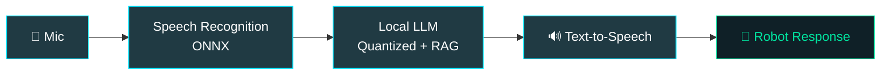

<div align="center">


<a href="https://git.io/typing-svg">
  
</a>

<br/>


</div>

---

## 👾 `whoami`

```bash
$ whoami
rehandra

$ cat profile.json
{
  "role"      : "Computer Science Student @ Universitas Riau",
  "focus"     : ["Embedded Systems", "Robotics", "Edge AI", "ML", "Software Engineering"],
  "philosophy": "Learn by building. Understand how things work under the hood.",
  "currently" : "Squeezing AI models into resource-constrained devices",
  "fuel"      : "coffee + curiosity + compile errors ☕"
}

$ _
```

> I enjoy experimenting with low-level hardware, developing intelligent applications, and optimizing AI models to run where resources are tight.

---

## 🛠️ Tech Stack

<div align="center">

### 💻 Languages


### 🤖 Embedded & Robotics

<br/>


### 🧠 AI / ML


### 🌐 Web


### ⚙️ Tools


</div>

<details>
<summary><b>📖 Lihat detail kemampuan</b></summary>
<br/>

| Area | What I do |
|------|-----------|
| 🔌 **Embedded** | Microcontroller programming, hardware interfacing, sensors, motor control & PWM, I²C |
| 🤖 **Robotics** | Mobile robotics, holonomic drive systems, embedded Linux, edge-device deployment |
| 🧠 **AI / ML** | NLP, TF-IDF + SVM text classification, speech recognition, voice-command systems |
| ⚡ **Edge AI** | Local LLM inference, model quantization, RAG, benchmarking & latency analysis |
| 🌐 **Web** | Full-stack, RESTful apps, responsive UI, SQL & NoSQL integration |

Also familiar with Docker, Linux environments, Arduino IDE, Jupyter Notebook, and Adobe creative tools.

</details>

---

## 🚀 Featured Projects & Research

### 🗣️ Edge AI Voice Assistant
Local voice-assistant pipeline for intelligent robotic applications on resource-constrained hardware.



`ONNX` · `Quantization` · `RAG` · `Raspberry Pi` · `TTS`

---

### 🤖 Mobile Robotics & Embedded Control
ESP32-based robotic platforms and motor-control systems.

- 🧩 Multi-microcontroller architectures
- 📡 Sensor integration and hardware communication
- ⚙️ Motor drivers, PWM control, and holonomic movement
- ⏱️ Control strategies and real-time task performance

`ESP32` · `PWM` · `I²C` · `Holonomic Drive`

---

### 📊 Machine Learning & NLP
Machine-learning pipelines for text classification.

```text
Data Collection → Preprocessing → TF-IDF → SVM / Naive Bayes → Evaluation
                                                                    ↓
                                              Generalization & Overfitting Analysis
```

`scikit-learn` · `TF-IDF` · `SVM` · `Naive Bayes`

---

### 📱 EnerGo — Mobile AR Project
Augmented reality app development with **Unity**, **AR Foundation**, and **ARCore**.

`Unity` · `AR Foundation` · `ARCore`

---

## 🎯 Current Interests

<div align="center">

| ⚡ Edge AI | 🧠 On-device Inference | 🤖 Robotics |
|:---:|:---:|:---:|
| Efficient on-device inference | Model quantization & optimization | Control systems & autonomous navigation |

| 🔌 Embedded Intelligence | 🗣️ Speech & HRI | 🔬 R&D |
|:---:|:---:|:---:|
| Real-time systems | Speech processing, human-robot interaction | Advanced technologies |

</div>

---

## 📊 GitHub Stats

<div align="center">


</div>

---

## 🐍 Contribution Snake

<div align="center">

<!-- Butuh GitHub Action Platane/snk, lihat catatan di bawah README ini -->


</div>

---

## 📫 Connect With Me

<div align="center">

[](https://github.com/Rehandra145)
[](https://www.instagram.com/handeraaa)

</div>

---

<div align="center">

```text
┌──────────────────────────────────────────────┐
│  while (alive) { build(); break(); learn(); }│
└──────────────────────────────────────────────┘
```


</div>

<!--
CATATAN SETUP SNAKE:
1. Buat file .github/workflows/snake.yml di repo Rehandra145/Rehandra145:

name: Generate Snake
on:
  schedule:
    - cron: "0 */12 * * *"
  workflow_dispatch:
permissions:
  contents: write
jobs:
  generate:
    runs-on: ubuntu-latest
    steps:
      - uses: Platane/snk/svg-only@v3
        with:
          github_user_name: ${{ github.repository_owner }}
          outputs: |
            dist/github-contribution-grid-snake-dark.svg?palette=github-dark
      - uses: crazy-max/ghaction-github-pages@v3.1.0
        with:
          target_branch: output
          build_dir: dist
        env:
          GITHUB_TOKEN: ${{ secrets.GITHUB_TOKEN }}

2. Jalankan workflow sekali dari tab Actions, lalu snake akan muncul.
-->
