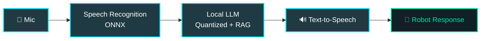

<div align="center">

<!-- HEADER WAVE -->


<!-- TYPING SVG -->
<a href="https://git.io/typing-svg">
  
</a>

<br/><br/>

<!-- TOP BADGES -->

<a href="https://github.com/Rehandra145?tab=followers">
  
</a>


</div>

<br/>

## 👾 `whoami`

```bash
$ whoami
rehandra

$ cat profile.json
{
  "role"      : "Computer Science Student @ Universitas Riau",
  "focus"     : ["Embedded Systems", "Robotics", "Edge AI", "ML", "Software Engineering"],
  "philosophy": "Learn by building. Understand how things work under the hood.",
  "currently" : "Squeezing AI models into resource-constrained devices",
  "fuel"      : "coffee + curiosity + compile errors ☕"
}

$ _
```

> I enjoy experimenting with low-level hardware, developing intelligent applications, and optimizing AI models to run smoothly where compute resources are tight.

---

## 🛠️ Tech Stack

<div align="center">

#### 💻 Languages & Databases


#### 🤖 Embedded Systems & Robotics

<br/><br/>


#### 🧠 AI / Machine Learning / Edge Inference

<br/><br/>


#### 🌐 Web & App Development


#### ⚙️ Tools & Environment


</div>

<br/>

<details>
<summary><b>📖 Lihat Detail Kemampuan (Click to expand)</b></summary>
<br/>

| Area | What I Do |
| :--- | :--- |
| 🔌 **Embedded** | Microcontroller programming, hardware interfacing, sensor fusion, motor control & PWM, I²C / SPI / UART |
| 🤖 **Robotics** | Mobile robotics, holonomic drive kinematics, embedded Linux, real-time edge-device deployment |
| 🧠 **AI / ML** | Natural Language Processing (NLP), TF-IDF + SVM text classification, speech recognition, voice-command pipelines |
| ⚡ **Edge AI** | Local LLM inference, model quantization (INT8/FP16), RAG on edge, benchmarking & latency analysis |
| 🌐 **Web** | Full-stack development, RESTful APIs, responsive UI design, SQL & NoSQL integration |

*Also familiar with Docker containerization, Linux shell environments, Arduino IDE, PlatformIO, Jupyter Notebook, and Adobe creative tools.*

</details>

---

## 🚀 Featured Projects & Research

### 🗣️ 1. Edge AI Voice Assistant
Local voice-assistant pipeline designed for intelligent robotic applications on resource-constrained hardware.


`ONNX` · `Model Quantization` · `RAG` · `Raspberry Pi` · `Text-to-Speech`

<br/>

### 🤖 2. Mobile Robotics & Embedded Control
ESP32-based robotic platforms and precision motor-control systems.
- 🧩 **Multi-microcontroller architectures** for distributed sensor and actuator processing
- 📡 **Sensor integration** and low-latency hardware communication protocols
- ⚙️ **Motor drivers, PWM control, and holonomic movement** kinematics
- ⏱️ **Control strategies** optimized for real-time task execution

`ESP32` · `C/C++` · `PWM` · `I²C` · `Holonomic Drive`

<br/>

### 📊 3. Machine Learning & NLP Pipeline
End-to-end machine learning pipelines for automated text classification and model evaluation.

```text
Data Collection ──► Preprocessing ──► TF-IDF Vectorization ──► SVM / Naive Bayes ──► Evaluation
                                                                                         │
                                                                                         ▼
                                                                  Generalization & Overfitting Analysis
```
`Python` · `scikit-learn` · `TF-IDF` · `SVM` · `Naive Bayes`

<br/>

### 📱 4. EnerGo — Mobile AR Project
Interactive Augmented Reality mobile application built for immersive spatial visualization.

`Unity` · `C#` · `AR Foundation` · `ARCore`

---

## 🎯 Current Interests & Focus Areas

<div align="center">

| ⚡ Edge AI | 🧠 On-Device Inference | 🤖 Robotics |
| :---: | :---: | :---: |
| Efficient on-device inference & hardware acceleration | Model quantization, pruning & latency optimization | Control systems, kinematics & autonomous navigation |
| 🔌 **Embedded Intelligence** | 🗣️ **Speech & HRI** | 🔬 **Applied R&D** |
| Real-time bare-metal & RTOS systems | Speech processing & human-robot interaction | Prototyping next-gen intelligent hardware |

</div>

---

## 📊 GitHub Stats

<div align="center">
  
  
</div>

<div align="center">
  
</div>

<div align="center">
  
</div>

---

## 🐍 Contribution Snake

<div align="center">
  
</div>

---

## 📫 Connect With Me

<div align="center">

<a href="https://github.com/Rehandra145" target="_blank">
  
</a>
<a href="https://www.instagram.com/handeraaa" target="_blank">
  
</a>

<br/><br/>

```text
┌───────────────────────────────────────────────┐
│  while (alive) { build(); break(); learn(); } │
└───────────────────────────────────────────────┘
```


</div>
